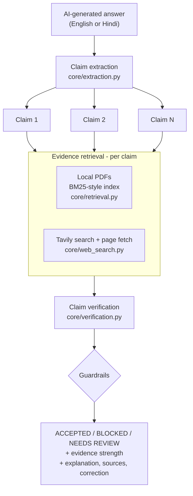
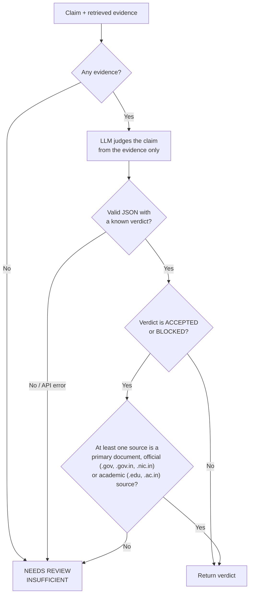
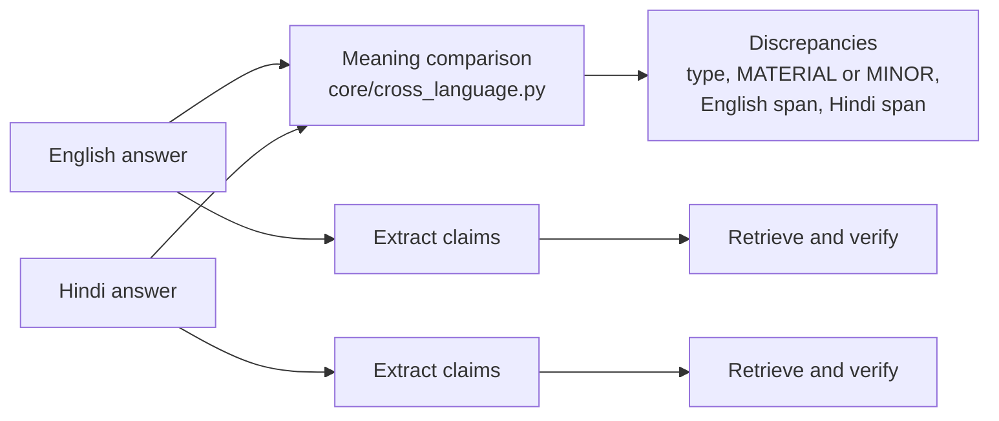

<div align="center">

# 🛡️ BhashaGuard

### An evidence-grounded auditor for AI-generated answers, in English and Hindi

*Don't trust the answer. Audit the claims.*


-C98A12)

[Overview](#overview) · [How it works](#how-it-works) · [Quick start](#quick-start) · [Usage](#usage) · [Evaluation](#evaluation) · [Limitations](#limitations-and-roadmap) · [Structure](#project-structure)

</div>

---

## Overview

A fluent AI answer can still contain a wrong deadline, an invented benefit amount, or an eligibility rule that no document states. Asking a second language model "is this true?" does not fix that, because the checker can hallucinate in exactly the same way.

BhashaGuard is a Streamlit application that audits an AI-generated answer **claim by claim, against retrieved evidence** instead of against a model's opinion:

1. An LLM splits the answer into atomic, independently checkable claims.
2. Evidence is retrieved for each claim from **local PDFs** and from the **live web** (Tavily, with page text fetched where possible).
3. An LLM judges the claim **only from the supplied evidence** and returns one of three verdicts.
4. Code-level guardrails downgrade any verdict that is not backed by a trustworthy source.

```text
ACCEPTED       evidence supports the claim
BLOCKED        credible evidence contradicts the claim
NEEDS REVIEW   evidence is missing, weak, conflicting or ambiguous
```

The third verdict is deliberate. **Not finding evidence is not the same as finding the claim false**, and for things like scheme eligibility, dates and benefit amounts, calling a true statement false can do real harm. BhashaGuard treats abstention as a first-class result.

It also has a separate **English–Hindi consistency check**: it finds where two versions of an answer differ in numbers, dates, eligibility, negation or omitted conditions, and then verifies each side against evidence independently. Two translations that agree with each other can both be wrong, so consistency and truth are kept apart.

> **Scope.** Built for the AI-FEST 2026 AI stream (*"Who Watches the Watchdog?"*). The evaluation data focuses on five Indian government schemes: ADIP, PMFME, PMAY-U 2.0, SEED and National Horticulture Board schemes. BhashaGuard is not a universal fact-checker and does not audit bias.

> **Honest status.** The benchmark labels in this repository are **provisional**: zero records have been checked against the original PDFs. Read [Evaluation](#evaluation) before quoting any number from this project.

## Key features

| Capability | What it does | Why it matters |
|---|---|---|
| **Atomic claim extraction** | Splits compound statements into separate claims while preserving numbers, dates, units, conditions, exceptions and negation. | A paragraph can be half right. Each claim gets its own verdict. |
| **Two evidence paths** | A local PDF index (BM25-style lexical ranking) and Tavily web search with page-text extraction. | Combines a controlled document set with broader public sources. |
| **Source-aware verdicts** | Evidence is tagged `primary document`, `official web source`, `academic web source`, `web source`, `search result only` or `irrelevant page`. | A search-result snippet is never treated as a verified source. |
| **Abstention by construction** | No evidence, or no trusted source, forces `NEEDS REVIEW` in code, not just in the prompt. | The model cannot talk its way into a confident verdict. |
| **English–Hindi comparison** | Detects `MATERIAL` and `MINOR` discrepancies between two versions, then verifies each language's claims independently. | Catches translations that quietly change an amount or a condition. |
| **Built-in benchmark harness** | Runs the production pipeline on labelled cases and reports confusion matrix, macro-F1, false acceptance, false blocking, abstention, coverage, selective accuracy, latency and API failures. | The auditor reports its own error rate rather than asserting that it works. |
| **Provisional vs verified evaluation** | Imported candidate data runs in `provisional` mode; `verified` mode has zero eligible cases until someone reviews the sources. | Prevents unreviewed labels from being reported as ground truth. |

## How it works



### Verification logic

The verifier sends the claim and up to 2,200 characters from each evidence item to the model with instructions to use only that evidence. The response is then constrained by code in [`core/verification.py`](core/verification.py):



Two label sets are reported and never conflated:

- **Verdict:** `ACCEPTED`, `BLOCKED`, `NEEDS REVIEW`.
- **Evidence strength:** `STRONG`, `MODERATE`, `INSUFFICIENT`. This is a label produced by the model under instruction, not a calibrated probability.

A `NEEDS REVIEW` result never carries a suggested correction. For other verdicts, the model is instructed to suggest a correction only when the supplied evidence directly supports it; the app does not independently verify the correction text.

### How evidence is retrieved

**Local PDFs** ([`core/retrieval.py`](core/retrieval.py)). PDFs under `data/documents/` are read with PyMuPDF, split into overlapping 1,050-character chunks (850-character stride), tagged Hindi or English by Devanagari detection, and cached in `data/index/pdf_index.json`. Ranking is a small BM25-style scorer with three boosts: an exact-phrase match, a per-number match, and a 1.08× multiplier for chunks in the claim's language. It does not use embeddings and does not download a model. Indexing is **always explicit**, never a side effect of an audit or a benchmark run. The index is invalidated when a PDF's path, size or modification time changes.

**Web** ([`core/web_search.py`](core/web_search.py)). One Tavily `advanced` search per claim (top 5 results), then each result page is fetched and reduced to passages that overlap the claim's terms. When a claim contains digit-bearing tokens, a passage must contain at least one of those tokens to pass the numeric filter; this does not check that every number in the claim appears in the passage. If the page cannot be retrieved, a relevant Tavily snippet may be used but is tagged `search result only`, and the UI flags it as not conclusive.

### English–Hindi consistency



Comparison and verification are independent. The comparison prompt explicitly says not to decide truth from agreement, and each language's claims go through the full evidence pipeline on their own. A discrepancy tells you the versions differ; it does not tell you which one is right.

## Technology stack

| Layer | Technology | Role |
|---|---|---|
| Language | Python 3.11 | Application and evaluation code |
| UI | Streamlit | Four-tab app, sidebar key configuration |
| LLM | [Groq](https://groq.com) chat completions API | Claim extraction, evidence judgement, bilingual comparison, sample-question generation |
| Search | [Tavily](https://tavily.com) search API + direct page fetch via `requests` | Live web evidence |
| PDF | PyMuPDF (`pymupdf`) | Text extraction for the local index |
| Retrieval | Hand-written BM25-style lexical ranker | Local passage ranking with phrase, number and language boosts |
| Testing | `unittest` | 12 offline tests for metrics, splits, retrieval and usage tracking |

**Models.** BhashaGuard requests the models available to the supplied key from Groq and picks the first available ID from this preference list ([`core/llm.py`](core/llm.py)): `openai/gpt-oss-120b`, `qwen/qwen3.8-27b`, `openai/gpt-oss-20b`, `llama-3.3-70b-versatile`. Groq has deprecated `llama-3.3-70b-versatile` for free and developer tiers, so it will be skipped when the key's model list does not include it ([Groq deprecation notes](https://console.groq.com/docs/deprecations)). If no preferred ID is available, the code falls back to the alphabetically first listed model whose ID does not contain several known non-chat terms. This is a name-based heuristic; compatibility is confirmed only when a chat-completion request succeeds. Calls use `temperature=0`. Each benchmark run records the application's current model ID; if a run fails before model selection completes, that value may not identify a model that successfully completed a request. No model is trained or fine-tuned; BhashaGuard orchestrates existing models.

Dependencies are listed in [`requirements.txt`](requirements.txt): `streamlit>=1.38,<2`, `requests>=2.32,<3`, `PyMuPDF>=1.24,<2`. **Compatibility note:** the app uses Streamlit `width="stretch"` arguments, supported by Streamlit 1.49 and later. The current requirements range permits older versions, so the install commands below explicitly require `streamlit>=1.49`. The application and offline test suite were verified here with Streamlit 1.67.0 and PyMuPDF 1.28.2.

## Quick start

### Prerequisites

- Python 3.11
- A [Groq API key](https://console.groq.com) (required)
- A [Tavily API key](https://tavily.com) (optional; without it only local PDF evidence is used)

### Install and run

**Windows (PowerShell)**

```powershell
git clone https://github.com/AkashGoswamy/BhashaGuard.git
cd BhashaGuard
py -3.11 -m venv .venv
.\.venv\Scripts\Activate.ps1
python -m pip install --upgrade pip
pip install "streamlit>=1.49" -r requirements.txt
streamlit run app.py
```

If PowerShell blocks activation, run `Set-ExecutionPolicy -Scope Process -ExecutionPolicy Bypass` in that window first.

**macOS / Linux**

```bash
git clone https://github.com/AkashGoswamy/BhashaGuard.git
cd BhashaGuard
python3.11 -m venv .venv
source .venv/bin/activate
pip install --upgrade pip
pip install "streamlit>=1.49" -r requirements.txt
streamlit run app.py
```

Then open the URL Streamlit prints, paste your keys into the **sidebar**, and press **Validate keys**.

> **No `.env` file is needed.** In the app, keys are entered in the sidebar and held in Streamlit session state for that session; the CLI requests them with hidden input. Keys are sent to Groq or Tavily when needed for authentication, but are not written to project files or benchmark results. The model-selection cache stores a SHA-256 fingerprint rather than the raw key. **Clear keys and session** clears the app session and model cache. Groq error messages redact the key.

### Add the local evidence library (optional)

Put PDFs in `data/documents/` (subfolders are scanned). Then open **PDF library → Refresh PDF index**. The current `.gitignore` pattern (`data/documents/*.pdf`) ignores PDFs directly inside `data/documents/`, but does not cover PDFs in nested subfolders. The app scans subfolders, so check `git status` and ensure nested PDFs are ignored before committing them. A fresh clone has no local evidence library unless PDFs are committed or added separately. Scanned PDFs with no extractable text are reported as needing OCR; BhashaGuard does not perform OCR.

### Run the tests

```bash
python -m unittest discover -s tests -v
```

The tests are offline and need no API keys.

## Usage

### The app

| Tab | Purpose |
|---|---|
| **Single-answer audit** | Paste an AI answer, choose English or Hindi, and get per-claim verdicts with evidence, source links, explanations and corrections. |
| **English–Hindi comparison** | Paste two versions, see them side by side, read the detected discrepancies, then see independent evidence checks for the claims in each language. |
| **PDF library** | Index local PDFs, see document and passage counts, and generate sample questions from the indexed text. |
| **Evaluation** | Inspect the candidate datasets, run development or held-out benchmarks, and drill into every case and its retrieved evidence. |

A claim result shows the verdict badge, evidence strength, the assessment, an optional correction, and every evidence item with its source type. When nothing was retrieved, the UI says so and keeps the verdict at `NEEDS REVIEW`.

### As a library

The pipeline functions can be used without the UI:

```python
import getpass
from core.extraction import extract_claims
from core.retrieval import retrieve_local
from core.web_search import search_web
from core.verification import verify_claim

groq_key = getpass.getpass("Groq key: ")
tavily_key = getpass.getpass("Tavily key (optional): ")

answer = "Applicants must be at least 18 years old. Applications close on 31 December."
claims, error = extract_claims(answer, groq_key, "English")

for claim in claims:
    local = retrieve_local(claim, "English")                        # needs an indexed PDF library
    web, note = search_web(claim, "English", tavily_key)            # empty list if no Tavily key
    result = verify_claim(claim, local + web, groq_key)
    print(claim, "->", result["verdict"], result["strength"])
```

`verify_claim` returns `{"verdict", "strength", "explanation", "correction"}`. With no evidence it needs no API call at all, and returns the abstention result directly:

```python
>>> verify_claim("Applicants must be at least 18 years old.", [], api_key="unused")
{'verdict': 'NEEDS REVIEW', 'strength': 'INSUFFICIENT',
 'explanation': 'No relevant evidence was retrieved; lack of evidence does not establish that the claim is false.',
 'correction': ''}
```

### Benchmark from the command line

```bash
# Factual claims: development split, at most 5 cases (default limit)
python -m core.benchmark_cli --split dev --kind claims --dataset imported --mode provisional --limit 5

# English-Hindi consistency
python -m core.benchmark_cli --split dev --kind bilingual --dataset imported --mode provisional --limit 5
```

The CLI prompts for keys with hidden input. `--limit 0` runs every eligible case. Each run is saved to `data/benchmark/results/` (git-ignored) with predictions, retrieved evidence, per-case latency, reported token usage, API failures, model ID, dataset version and split hash. API keys are never written to result files.

## Evaluation

BhashaGuard ships with an evaluation harness because an auditor that cannot report its own error rate is not worth trusting. The harness is the most conservative part of the codebase, and it is designed to resist flattering numbers.

### Methodology

- **Candidate data.** `data/json/` holds two candidate files, read-only and never rewritten by the app: `bhashaguard-eval-dataset.json` (the cases) and `bhashaguard_benchmark_final.json` (a companion with normalisation notes and per-record verification status). The cases were drafted with AI tools; they have not been checked against the source PDFs.
- **Composition.** 50 factual cases (30 English, 20 Hindi; 10 per scheme; 15 `ACCEPTED`, 25 `BLOCKED`, 10 `NEEDS REVIEW`) and 10 bilingual pairs.
- **Verification status.** 0 verified, 55 `NEEDS_SOURCE_VERIFICATION`, 5 `UNVERIFIABLE` (no usable source filename). The primary file's own metadata describes its records as verified; the app deliberately does not trust that and takes status from the companion file.
- **Deterministic splits.** Seed 42, roughly 70/30 development/held-out, grouped by scheme, source, page and claim so near-duplicate facts do not leak across splits. Bilingual pairs are kept whole. This yields 33 dev and 17 held-out factual cases, and 7 dev and 3 held-out bilingual pairs. Split assignments and their hash are stored with every run.
- **Held-out discipline.** The `final` split is for final measurement only. The UI and docs warn against tuning on it.
- **Case-level verdict.** A case can contain several claims. Its predicted verdict is `BLOCKED` if any claim is blocked, else `NEEDS REVIEW` if any claim needs review, else `ACCEPTED`.
- **Real pipeline.** The benchmark calls the same extraction, retrieval and verification functions as the app.
- **No silent PDF indexing.** A benchmark never indexes your library. If no current index exists, local retrieval simply returns nothing, and the run records this.

### Metrics reported

| Factual claims | Bilingual |
|---|---|
| Accuracy, per-class precision/recall/F1, macro-F1 | Pair-level accuracy (provisional consistency score) |
| Confusion matrix, including a `FAILED` column | Discrepancy precision, recall and F1 |
| **False acceptance** (BLOCKED predicted ACCEPTED) | Confusion matrix and per-category accuracy |
| **False blocking** (ACCEPTED predicted BLOCKED) | Coverage and selective accuracy |
| Abstention rate, coverage, selective accuracy | Latency, API failures, reported tokens |
| Breakdowns by language, scheme, category, difficulty | |
| Latency (mean, median, P95), API and webpage failures, tokens | |
| Recall@3, Recall@5, MRR, correct document/page, citation correctness (only for source-reviewed cases) | |

Design choices that keep the numbers honest:

- Failed or missing predictions count as **incorrect** and stay visible; they are never dropped from the denominator.
- Macro-F1 keeps classes that have support but received no predictions.
- Retrieval and citation metrics report "not measured" unless a case has a reviewed source reference. For the imported candidates they are unavailable.
- Verified mode shows no accuracy when there are no source-verified records.
- Token counts appear only when the provider reports them.
- A saved run that belongs to an earlier dataset version is labelled as historical.
- For manually reviewed datasets (`data/benchmark/*.json`), validation checks that each cited evidence passage **actually appears on the cited PDF page**, and rejects rows where it does not.

### Latest development run (provisional)

> **Read this first.** These come from small development-split runs on candidate labels with **zero source-verified records**. They are not verified accuracy and are far too small to generalise from. The factual run used web evidence only: the local PDF index held **0 chunks**, so it says nothing about retrieval from the PDF library. Run artefacts are git-ignored, so these figures are reported by the author and are reproducible with the commands above.

**Factual claims (5 of 5 cases completed)**

| Metric | Result |
|---|---:|
| Accuracy | 40.0% (2/5) |
| Macro-F1 | 33.3% |
| False acceptance | 0/2 (0%) |
| False blocking | 1/2 (50%) |
| Abstention rate | 60% (3/5) |
| Coverage | 40% (2/5) |
| Selective accuracy | 50% (1/2) |
| Latency mean / median / P95 | 44.4 s / 46.8 s / 72.3 s |
| Activity | 20 Groq calls · 14 Tavily searches · 70 page fetches (25 failed) · 24,325 tokens |

| Case | Expected | Predicted | Correct |
|---|---|---|:---:|
| BG-001 | ACCEPTED | NEEDS REVIEW | ✗ |
| BG-002 | ACCEPTED | BLOCKED | ✗ |
| BG-004 | BLOCKED | NEEDS REVIEW | ✗ |
| BG-006 | BLOCKED | BLOCKED | ✓ |
| BG-007 | NEEDS REVIEW | NEEDS REVIEW | ✓ |

Two of the three `NEEDS REVIEW` predictions (BG-001 and BG-004) were incorrect against the provisional labels; BG-007 was the expected `NEEDS REVIEW` result. BG-002 was falsely blocked after the Hindi scheme name was rendered as “IDP,” leading to confusion with unrelated IDP material. The 0/2 false-acceptance figure is encouraging but rests on two `BLOCKED` cases.

**Bilingual consistency (5 of 5 pairs completed)**

| Metric | Result |
|---|---:|
| Pair-level consistency (provisional) | 80% (4/5) |
| Discrepancy precision / recall / F1 | 50% / 100% / 66.7% |
| Mean latency | 5.27 s |

One equivalent pair, BG-BIL-003, was wrongly flagged as a discrepancy. The 100% recall rests on a single expected discrepancy. **This is a consistency score, not factual accuracy**, and it is never combined with the factual score.

## Project structure

```text
BhashaGuard/
├── app.py                      # Streamlit UI: sidebar keys, four tabs, claim and benchmark rendering
├── core/
│   ├── llm.py                  # Groq client, model selection, JSON parsing, API-usage tracking
│   ├── extraction.py           # Atomic claim extraction
│   ├── retrieval.py            # PDF indexing and BM25-style local retrieval
│   ├── web_search.py           # Tavily search, page fetch, passage extraction, source labelling
│   ├── verification.py         # Evidence-grounded verdicts and code-level guardrails
│   ├── cross_language.py       # English-Hindi comparison and discrepancy detection
│   ├── evaluation.py           # Dataset validation, verdict metrics, retrieval metrics, run summaries
│   ├── bilingual_evaluation.py # Bilingual benchmark and metrics
│   ├── benchmark.py            # Claim benchmark runner (production pipeline)
│   ├── benchmark_cli.py        # `python -m core.benchmark_cli`
│   └── source_data.py          # Read-only normalisation and deterministic splits of candidate JSON
├── data/
│   ├── json/                   # Supplied candidate datasets (read-only)
│   ├── benchmark/              # Schemas, plan, empty manual-review templates; results/ is git-ignored
│   ├── documents/              # Evidence PDFs; current ignore rule covers only top-level PDFs
│   └── index/                  # Generated PDF index cache (git-ignored)
├── tests/test_evaluation.py    # 12 offline unit tests
├── .streamlit/config.toml      # Light theme
└── requirements.txt
```

## Engineering decisions

- **A pipeline instead of one prompt.** Extraction, retrieval, verification, comparison and evaluation are separate modules, so each can be tested, measured and improved independently. Retrieval failures and reasoning failures show up as different things in the benchmark.
- **Guardrails in code, not only in prompts.** Prompts ask the model to abstain; `verification.py` also enforces it. A model verdict without a trusted source is downgraded, and an unreadable or failed model response becomes `NEEDS REVIEW`.
- **Search snippets are second-class evidence.** Snippets are kept, labelled and shown, but they cannot make a decisive verdict alone.
- **Numbers receive a mechanical relevance check.** A web passage must contain at least one digit-bearing token from the claim to pass the numeric filter; it can still omit other claim numbers. Local ranking boosts matching numbers. This helps surface numerical evidence but does not prove every figure is correct.
- **Lexical retrieval on purpose.** A small BM25-style ranker keeps the app light and easy to inspect, with no embedding model to download. The trade-off is weaker semantic matching, which matters most for Hindi paraphrases and scheme names.
- **Evaluation as a feature.** Provisional and verified modes, grouped splits, failed-as-incorrect scoring and held-out warnings exist to stop the benchmark from flattering the system.
- **Session-based secrets.** App keys are held in Streamlit session state and CLI keys are read with hidden input. Credentials are sent to the relevant provider for authentication, are not written to project or result files, and Groq error messages redact them. The process-local model cache stores only a SHA-256 fingerprint of the key.

## Limitations and roadmap

### Known limitations

- **No source-verified benchmark data.** All 60 candidate records are unverified. Reported numbers are provisional.
- **Tiny evaluated samples.** The latest runs cover 5 factual cases and 5 bilingual pairs. The full dev and held-out splits have not been run and reported.
- **Local PDF path not yet benchmarked.** The latest factual run used web evidence only.
- **Weak spots seen in testing:** Hindi scheme-name retrieval, snippet-only evidence, failed page fetches (JavaScript-only or access-restricted pages), and a false positive in bilingual comparison.
- **Latency.** Claims are processed sequentially, and each costs one search, up to five page fetches and one model call. The latest factual run averaged 44.4 s per case.
- **Source trust is domain-based.** Hosts ending in `.gov`, `.gov.in`, `.nic.in`, `.edu` and `.ac.in`, plus the bare `gov.in` and `nic.in` hosts and local PDFs, count as trusted. The guardrail checks that a trusted source is present among the evidence, not that this source is the one supporting the verdict; the model's reading of the evidence still matters.
- **LLM judgement is not deterministic proof.** Calls use `temperature=0`, but different available models can behave differently, and repeated-run consistency has not been measured.
- **External dependencies.** Groq and Tavily availability, quotas and rate limits apply. Only one Tavily query is made per claim.
- **Narrow scope.** Selected government schemes, English and Hindi. No OCR for scanned PDFs. No bias auditing. High-impact claims still need an authoritative or human check.

### Roadmap (planned, not implemented)

1. Verify every benchmark record against the original PDFs, then report verified-mode metrics.
2. Index the PDF library and benchmark local retrieval, including Recall@k and citation correctness.
3. Improve Hindi scheme-name handling and semantic retrieval.
4. Run the complete dev and held-out splits; measure repeated-run consistency.
5. Reduce latency, for example by parallelising per-claim work.

## Privacy and responsible use

- Text you audit is sent to **Groq**. Claim text (up to 400 characters) is sent to **Tavily**, and BhashaGuard then fetches the result pages directly.
- Do not submit personal or confidential data. The evaluation corpus uses public government documents.
- Treat `NEEDS REVIEW` as unresolved, and inspect the source passages before relying on any verdict.

## Deployment

The existing setup targets Streamlit Community Cloud (`app.py` as entry point, `requirements.txt` for dependencies) or a Hugging Face Space using the Streamlit SDK. Keys are entered in the sidebar after launch. A hosted app cannot read PDFs on your laptop, so include the documents in the deployment or provide them through your own storage workflow. This repository has not been verified on either platform.

## Contributing

Issues and pull requests are welcome, especially source-verified benchmark records, retrieval improvements and Hindi test cases. When you change behaviour:

1. Run `python -m unittest discover -s tests -v`.
2. Do not tune prompts or code against the `final` split.
3. Never commit API keys or evidence PDFs.
4. Mark any benchmark record as verified only after checking the filename, printed page, exact passage, language, conditions, dates, units and verdict against the original PDF. See [`data/benchmark/README.md`](data/benchmark/README.md) for the record schema.

## License

No `LICENSE` file is currently included in this repository, so no open-source license is granted. Add one before inviting reuse.

## Acknowledgments

- [Groq](https://groq.com) for hosted LLM inference and [Tavily](https://tavily.com) for web search.
- [Streamlit](https://streamlit.io) and [PyMuPDF](https://pymupdf.readthedocs.io) for the UI and PDF text extraction.
- Public Indian government scheme documents used as the intended evidence corpus.
- The candidate benchmark records were drafted with AI-tool assistance and have not yet been independently verified.
- Built for the **AI-FEST 2026** AI stream, *"Who Watches the Watchdog?"*
